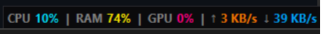

# WinMonitor


A lightweight, elegant, and non-intrusive hardware system monitor for Windows. It provides both a customizable floating desktop status bar and an interactive system notification tray icon with live gauges and statistics.



---

## Features

### 🖥️ Floating Status Bar
- **Real-Time Metrics**: Displays live readings for CPU usage, RAM utilization, GPU usage (NVIDIA), network upload/download speeds, and physical disk activity.
- **Per-Drive Performance**: Real-time read (↑) and write (↓) load percentages per partition or physical drive (e.g. `C: ↑ 0% ↓ 5%`).
- **Granular Drive Selection**: Select exactly which drives to monitor (or hide) via the **Select Disks** context menu.
- **Customizable Modules**: Toggle any metric on or off (CPU, RAM, Disk, GPU, Network) directly from the context menu.
- **Temperature Monitoring & Overheat Alerts**: Monitors CPU package and GPU core temperatures (via CoreTemp, LibreHardwareMonitor, or OpenHardwareMonitor) with configurable visual warning alerts when thresholds are reached.
- **Smooth Collapsed Mode**: Shrinks the bar to a compact mini-gauge when idle. Smoothly expands when hovered over (debounced to eliminate flicker) and cleanly collapses when the cursor moves away.
- **Multi-Monitor & DPI-Aware Dragging**: Drag with the left mouse button to position the bar anywhere across single or multi-monitor configurations without jumping, drifting, or DPI scaling misalignments.
- **Fixed Right Anchor**: Automatically expands and contracts from the left while keeping the right edge anchored exactly where you placed it.
- **Always on Top & Clean Taskbar**: Stays above other application windows without cluttering the Windows taskbar (`WS_EX_TOOLWINDOW`).

### 🔔 System Tray Integration
- **Live CPU Gauge Icon**: Displays real-time CPU utilization directly in the Windows notification area tray.
- **Instant Stats Tooltip**: Hover over the tray icon to see an instant summary of CPU%, RAM%, disk activity, GPU%, and network speeds.
- **Full Tray Context Menu**: Right-click the tray icon to toggle the floating bar, toggle modules, switch collapsed mode, set temperature thresholds, toggle startup on boot, or exit.
- **Minimize to Tray**: Closing the floating bar (`Alt+F4` or close signal) withdraws it to run silently in the background tray. Double-clicking the tray icon brings the floating bar back.

---

## Requirements

- **OS**: Windows 10 or Windows 11 (64-bit recommended)
- **Python** (if running from source): Python 3.10+

### Dependencies
```bash
pip install -r requirements.txt
```

*Required packages:*
- `psutil` (system & hardware metrics)
- `nvidia-ml-py` (NVIDIA GPU utilization and temperature)
- `wmi` & `pypiwin32` (Windows performance counters and hardware queries)
- `pillow` (dynamic icon rendering)
- `pystray` (system tray icon and menu integration)

*(If optional hardware sensors or packages are absent, WinMonitor gracefully adapts and hides unsupported modules while running normally).*

---

## Running the Application

### Option 1: Pre-compiled Executable (Easiest)
Download `WinMonitor.exe` from the [Releases](../../releases) section and run it. No Python installation required.

> **Tip:** If the system tray icon does not appear directly on the taskbar, check the Windows hidden notification icons area (click the `^` arrow next to your system clock).

### Option 2: Run from Python Source
```bash
python WinMonitor.py
```

---

## Controls & Usage

| Action | How-To |
|---|---|
| **Move Floating Bar** | Left-click and drag anywhere on the bar |
| **Open Menu (Bar)** | Right-click directly on the floating bar |
| **Open Menu (Tray)** | Right-click the WinMonitor icon in the system tray |
| **Show / Hide Floating Bar** | Double-click the system tray icon, or use the tray menu toggle |
| **Minimize Bar to Tray** | Focus the bar and press `Alt+F4`, or uncheck "Show Floating Bar" in tray |
| **Toggle Collapsed Mode** | Right-click → Check/Uncheck **"Collapsed Mode"** |
| **Set Overheat Alert Temp** | Right-click → **"Set Temp Threshold..."** (defaults to 80°C) |
| **Filter Specific Disks** | Right-click the bar → **Select Disks** → Check/uncheck drives |
| **Toggle Auto-Run on Boot** | Right-click → Check/Uncheck **"Startup App"** |
| **Completely Exit** | Right-click tray icon or bar → **Exit** |

---

## Configuration

All preferences are automatically saved to `winmonitor_config.json` next to the executable (or in the user profile directory if permissions require):
- Module visibility (`show_cpu`, `show_ram`, `show_gpu`, `show_disk`, `show_network`)
- Floating bar state (`show_bar`, `collapsed_mode`)
- Excluded disk drives (`disabled_disks`)
- Temperature alert threshold (`temp_threshold`)

---

## Building from Source

To compile the application into a single standalone `.exe` using PyInstaller:

```bash
# 1. Install dependencies
pip install -r requirements.txt pyinstaller

# 2. Build using spec file
pyinstaller WinMonitor.spec --noconfirm

# 3. Output binary will be in:
dist/WinMonitor.exe
```

---

## Adding to Windows Startup

WinMonitor provides three ways to launch automatically when you sign into Windows:

### Method 1: Built-in Menu Toggle (Recommended)
1. Run `WinMonitor`.
2. Right-click the floating bar or the system tray icon.
3. Click **"Startup App"** to enable it. This automatically registers the application in your user registry (`HKCU\Software\Microsoft\Windows\CurrentVersion\Run`).

### Method 2: Windows Startup Folder
1. Press `Win + R`, type `shell:startup`, and press **Enter**.
2. Right-click inside the folder and choose **New > Shortcut**.
3. Browse and select your `WinMonitor.exe`, then click **Finish**.

---

## License
Distributed under the [MIT License](LICENSE).
